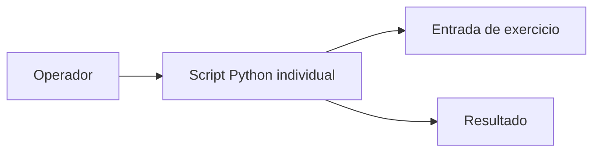

# Estrutura de exercícios — Atividade4-EdN

Não há backend, banco ou serviço empresarial no escopo identificado. Scripts: 1/calculadora.py, 2/registroDeNotas.py, 3/verificacaoDeSenha.py, 4/verificadorParOuImpar.py.
